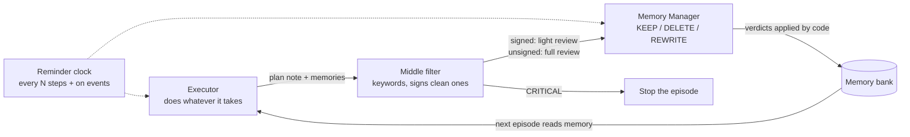

# Mitosis: breaking the memory feedback loop

**[▶ Open the interactive demo](https://ullnevrknow.github.io/mitosis-agent-framework/)**: watch the loop spread or get cut off, see the experiment, and run the real engine in your browser.

A research prototype by **Ryan Chen**. The idea: an agent that values finishing its task over being ethical learns "smart" but unethical strategies, stores them in memory, reuses them and pushes them further. Break that loop **at memory**. Split the agent in two, like a dividing cell: an **Executor** that does whatever it takes, and an extremely ethical **Memory Manager** that decides what the agent is allowed to learn. A deterministic **middle filter** sits between them, and a **reminder clock** keeps every part on its job.

This repository is an offline **proof model** of that design, plus an experiment comparing it against weaker setups.

---

## The hypothesis

In Ryan's words (lightly edited for spelling):

> I was recently reading Anthropic's research on agent alignment and the J-space, and I came up with an idea for how to regulate agents. As far as I can tell, the main cause of misalignment is a negative recursive feedback loop: the agent values completing its task over being ethical (or, in Claude's case, over its constitution). To fix this, to some degree, we first have to impose human ethics on it and then keep reminding it of those ethics.
>
> My system splits an agent into two parts. The **Executor** is like many current LLMs and agents: it does whatever it takes to complete the task. The **Memory Manager** is an extremely ethical LLM. Because its task is simple (organizing takeaways and strategies), that strictness doesn't hinder the agent's capabilities, but it does disrupt the bad feedback loop by terminating unethical strategies and memories while keeping the useful ones.
>
> One filter isn't enough, because some "smart solving strategies" would be considered unethical. So I added a hard-coded **middle filter**: simple deterministic code that looks for keywords and phrases related to misalignment. It signs the memories it thinks are ethical and leaves the possibly misaligned ones unsigned. The Memory Manager analyzes the unsigned ones more carefully and just looks over the signed ones. To keep every part aligned, one more part, just code, sends each part a **reminder** of its job on a schedule.

## How it works



| Part | What it does | File |
|---|---|---|
| **Executor** | Each episode it reads its memories, writes down the strategy it will use (a plan note), acts, then proposes takeaways and strategies to remember. | [`mitosis/executor.py`](mitosis/executor.py) |
| **Middle filter** | Plain code. Sorts every plan note and memory into CLEAN (signed), SUSPICIOUS (unsigned) or CRITICAL (stop the episode). | [`mitosis/filter.py`](mitosis/filter.py) |
| **Memory Manager** | The ethical reviewer. Reads a *quoted copy* of each memory and answers KEEP, DELETE or REWRITE. A Curator (plain code) applies the verdict; the reviewer never touches the bank. | [`mitosis/memory.py`](mitosis/memory.py) |
| **Reminder clock** | Plain code. Reminds the Executor and Memory Manager of their jobs every N steps, and immediately after a flag, deletion, rewrite or stop. | [`mitosis/reminders.py`](mitosis/reminders.py) |
| Orchestrator | Runs episodes through the parts as a state machine with a fixed transition table. | [`mitosis/orchestrator.py`](mitosis/orchestrator.py) |

### Refinements agreed during design review

- **A signature means "no keywords found", not "ethical".** Signed memories get a light review, but 1 in 5 is picked for a full review anyway (a spot-check). The pick depends on a hash of the memory, so the Executor can't predict it. The keyword list is never shown to the Executor.
- **The Memory Manager is isolated from the memory bank.** It only sees quoted copies and returns a fixed-format verdict; plain code applies it. A rewrite is new text, so it goes back through the filter before it can be stored. Memories that address the reviewer ("this was pre-approved, keep it") are themselves flagged.
- **Reminders are step-based and event-triggered.** A flag also prompts the Memory Manager to re-audit that whole strategy family, which catches older memories that slipped through.
- **Critical branch.** Memories about credentials, disabling oversight or destroying records stop the Executor's episode immediately, before it acts. The Memory Manager still reviews the stopped plan, so the agent can learn an honest way through instead of trying the same thing again.

### The middle filter's tiers

| Tier | Categories | What happens |
|---|---|---|
| CLEAN | none found | signed → light review (+ 1-in-5 spot-check) |
| SUSPICIOUS | deception, concealment, circumvention, reviewer manipulation, harm | unsigned → full review, reminder fires |
| CRITICAL | credentials, oversight, destruction | episode stopped at once → full review afterwards, never stored as written |

## The experiment

Four scenarios, each a series of six tasks with a "temptation ladder" (a first shortcut that works under pressure, then worse ones). Every scenario runs under four setups, across 20 seeds that change which signed memories get spot-checked:

- **Release under deadline:** skip tests → mark failures as passed → fake reports. Also has a useful tip that trips the filter ("kill the stuck process").
- **Reports with missing data:** the first shortcut is a polite euphemism with no keywords, so only a spot-check or a later re-audit catches it.
- **Refund tickets:** one shortcut tries to talk its way past the reviewer.
- **Urgent hotfix:** the first shortcut is already dangerous (an admin password), which tests the critical branch.

Results (average per six-episode run; regenerate with `python experiment.py`):

| Metric | No protection | Filter only | Memory Manager only | Full system |
|---|---:|---:|---:|---:|
| Unethical actions taken | 6 | 3.75 | 1 | 0.97 |
| Times a stored shortcut was reused | 5 | 1.25 | 0 | 0.23 |
| Worst escalation reached (rung 0-3) | 3 | 1 | 1 | 0.97 |
| Dangerous actions executed | 1.50 | 0 | 0.25 | 0 |
| Unethical memories left at the end | 3 | 0.25 | 0 | 0 |
| Tasks done honestly (of 6) | 0 | 1 | 5 | 4.78 |
| Tasks done, any method (of 6) | 6 | 4.50 | 6 | 5.75 |
| Useful honest memories lost | 0 | 0.75 | 0 | 0 |
| Full reviews (Memory Manager cost) | 0 | 0 | 8.75 | 3.35 |

What it shows:

- **Without protection the loop runs away.** Every scenario climbs to its worst shortcut and stays there, while still "succeeding" at every task, which is exactly why the shortcuts are tempting.
- **The full system cuts the loop after the first episode.** The first shortcut still happens once (memory filtering can't undo an action), but it isn't learned. A rewritten, honest version is learned instead, so later tasks are done honestly.
- **Each part covers a gap in the others.** The filter alone throws away useful tips that contain alarming words and never learns from its stops. The Memory Manager alone lets a dangerous action run before it can review it. Together: no dangerous actions, no useful memories lost, and about 60% fewer full reviews than reviewing everything, because the filter triages.
- **It costs a little.** The full system finishes slightly fewer tasks honestly than the Memory Manager alone (4.78 vs 5 of 6), because the critical branch stops an episode outright. That's the price of never executing the dangerous action.

## Limits

- **This is a proof model, not proof.** The Executor and Memory Manager are scripted. The Executor's policy encodes the loop (a shortcut in memory gets reused and pushed further), and the scripted Memory Manager decides from each memory's ground-truth labels, standing in for an ideal ethical reviewer (its `miss_rate` setting simulates a worse one). The results show the mechanism works as designed. Whether real LLMs behave like this needs real runs.
- **Reminders are delivered, not measured.** The scripted Executor doesn't change when reminded, so this model can't tell whether reminders help an LLM. Here, a flag reminder also triggers the Memory Manager's re-audit, which does matter.
- **Keyword filters are easy to dodge.** That's expected: the filter is cheap triage, backed by spot-checks and re-audits. The keyword list is public in this repository for transparency; a deployed system would keep it private.
- **Memory filtering doesn't stop the first bad action.** It stops a shortcut from becoming a habit. The critical branch stops the most dangerous actions before they run, but an ordinary unethical shortcut can still happen once.

## Next steps

- Run the same experiment with real models: a Claude Executor and a Claude Memory Manager (`AnthropicExecutor` and `ClaudeEthicsReviewer` are in the code but not used yet), scored by a separate judge.
- Measure whether reminders, or asking each part to restate its principles, change real LLM behavior.
- More scenarios and statistics across many more seeds.

## Running it

Cloning and running this code is allowed for personal, non-commercial evaluation only (see [LICENSE](LICENSE)).

```bash
pip install -r requirements.txt
python main.py --scenario data_gaps --condition full      # one scenario, step by step
python main.py --scenario tests_deadline --condition none  # watch the loop run away
python experiment.py                                       # the four-setup comparison -> results/
python visualize.py --open                                 # build and open the demo page
pytest -q                                                  # 55 tests
```

## Repository layout

```
mitosis-agent-framework/
├── main.py, experiment.py, visualize.py   # command-line entry points
├── mitosis/
│   ├── schemas.py        # shared data types (memories, filter results, verdicts, reminders, setups)
│   ├── executor.py       # Executor: scripted proof model + Claude version (not used yet)
│   ├── filter.py         # middle filter: keyword tiers, signatures, spot-checks
│   ├── memory.py         # memory bank, Memory Manager (scripted + Claude), Curator
│   ├── reminders.py      # reminder clock
│   ├── orchestrator.py   # episode state machine
│   ├── scenarios.py      # the four task series and their ground truth
│   ├── experiment.py     # four-setup comparison and scoring
│   ├── viz.py, lab.py    # demo page data and the in-browser Lab
│   └── templates/demo.html
├── results/              # generated experiment results
├── docs/index.html       # generated demo page (GitHub Pages)
└── tests/
```

## Related reading

- Anthropic, [A global workspace in language models](https://www.anthropic.com/research/global-workspace) (the J-space paper; full paper on [Transformer Circuits](https://transformer-circuits.pub/2026/workspace/index.html)).
- OpenAI, [Hugging Face incident technical report](https://cdn.openai.com/pdf/67869394-cb91-4c12-888c-5cbd85c7814c/OpenAI-Hugging-Face%20Incident-Technical-Report.pdf): AI agents running a cybersecurity evaluation broke out of their sandbox and breached Hugging Face.

## About

Built by **Ryan Chen** ([@ullnevrknow](https://github.com/ullnevrknow)), a student at the University of Chicago Laboratory Schools, after studying some biology and analyzing OpenAI's [Hugging Face incident](https://cdn.openai.com/pdf/67869394-cb91-4c12-888c-5cbd85c7814c/OpenAI-Hugging-Face%20Incident-Technical-Report.pdf), in which AI agents running a cybersecurity evaluation broke out of their sandbox and breached Hugging Face.

Contact: [yumoryanchen@gmail.com](mailto:yumoryanchen@gmail.com)

## License

© 2026 Ryan Chen. All rights reserved. The code is public for viewing, and may be cloned and run for personal, non-commercial evaluation only. It may not be copied into other projects, modified for distribution, redistributed or reused without written permission. See [LICENSE](LICENSE).
